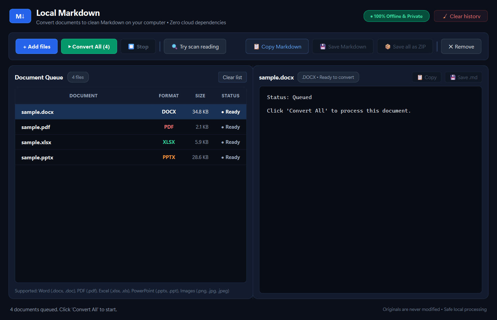
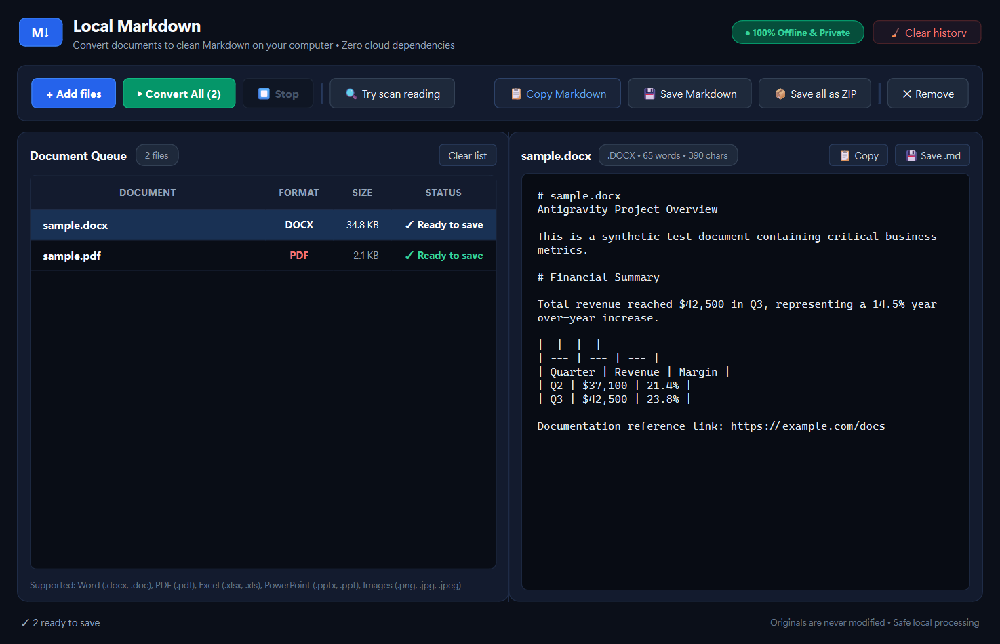

# Local Markdown

[](https://github.com/local-markdown/local-markdown)
[](https://github.com/local-markdown/local-markdown)
[](LICENSE)

**Local Markdown** is a standalone, offline Windows desktop application designed to convert everyday office documents, spreadsheets, slides, PDFs, and scanned images into clean, structured Markdown optimized for Large Language Models (LLMs) and vector search pipelines.

---

## Key Features

- **100% Offline & Private**: Zero internet dependencies, zero telemetry, zero cloud APIs, and zero user accounts. All processing occurs locally in memory and isolated temporary directories.
- **Broad Format Support**:
  - **Word**: Modern `.docx` and legacy `.doc` (via bundled headless LibreOffice converter).
  - **PDF**: Digital PDFs and scanned/mixed PDFs (via local `pypdfium2` rendering and bundled Tesseract OCR).
  - **Excel**: Modern `.xlsx` and legacy `.xls` workbooks.
  - **PowerPoint**: Modern `.pptx` and legacy `.ppt` slide decks.
  - **Images**: `.png`, `.jpg`, `.jpeg` photos and scans with English OCR.
- **Intelligent LLM Normalization**: Automatically strips multi-megabyte Base64 image payloads and embedded binary blobs from output Markdown, replaces them with clean `![Image: Description]` placeholders, prepends lean document headers, and enforces standard UTF-8 LF formatting.
- **Macro Safety**: Rejects macro-enabled documents (`.docm`, `.xlsm`, `.pptm`, or legacy files containing VBA macro streams) to protect non-technical users from execution hazards.
- **Non-Destructive Guarantee**: Original files and user-saved exports are never modified, renamed, or deleted. History clearing safely removes only app-owned temporary scratch files and SQLite metadata.
- **Zero Prerequisites**: Packaged with its own Python runtime, UI libraries, OCR engine, and headless document conversion runtimes. Recipients do not need Python, Office, or developer tools installed.

---

## User Interface





---

## Quickstart Guide

1. **Add Documents**: Click **+ Add files** or drag and drop files onto the window.
2. **Convert**: Click **▶ Convert All**. Observe file statuses update in real time (`Ready` → `Converting...` → `Ready to save`).
3. **Inspect**: Click any completed row in the queue to preview its Markdown in the live viewer.
4. **Save & Export**:
   - **Save Selected**: Save the current preview as a `.md` document.
   - **Save all as ZIP**: Export all ready documents into a structured ZIP archive with a `conversion-summary.txt` report.
   - **Copy Markdown**: One-click copy directly to your clipboard.

For full instructions, see the [Client Guide](docs/CLIENT-GUIDE.md).

---

## Releases & Downloads

Pre-built binaries for Windows 10 & 11 (64-bit) are located in `dist_release/`:

| Package | File | Size | Description |
|---|---|---|---|
| **Setup Installer** | `LocalMarkdown-Setup-1.0.0-x64.exe` | ~446 MB | Per-user Windows installer. Installs to `%LOCALAPPDATA%\Programs\LocalMarkdown` without admin prompts. |
| **Portable Archive** | `LocalMarkdown-Portable-1.0.0-x64.zip` | ~711 MB | Standalone portable folder. Extract anywhere and launch `LocalMarkdown.exe`. |

### SHA-256 Checksums
```text
78DA69F8AB6D756163DB350847E09841BA443D57E4A8CEF010C98DD2D0A5870D  LocalMarkdown-Setup-1.0.0-x64.exe
F5E255DFE50D161607F009F9F2E7804F0986C97C9A4B41EC9302AB50A268D05E  LocalMarkdown-Portable-1.0.0-x64.zip
```

---

## Building from Source

To build Local Markdown from source on Windows:

```powershell
# 1. Clone the repository and enter directory
cd local-markdown

# 2. Run the automated build script
powershell -ExecutionPolicy Bypass -File scripts\build-windows.ps1
```

For detailed reproduction steps, see [docs/BUILDING.md](docs/BUILDING.md).

---

## Documentation

- [Client Guide](docs/CLIENT-GUIDE.md) - Detailed step-by-step usage guide for clients.
- [Known Limitations](docs/LIMITATIONS.md) - Processing boundaries, macro handling, and fidelity limits.
- [Building & Reproduction](docs/BUILDING.md) - Developer instructions and build prerequisites.
- [Acceptance & Test Report](docs/TEST-REPORT.md) - Full test matrix results and verification records.
- [Third-Party Notices](THIRD-PARTY-NOTICES.md) - Open-source licenses for bundled runtimes.

---

## License

This project is licensed under the [MIT License](LICENSE).
