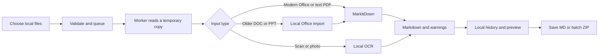

# Local Markdown: implementation plan

Prepared 25 October 2026. Status: approved user requirements translated into a build plan; application implementation has not started.

## 1. Product outcome

A nontechnical client should be able to convert everyday documents to Markdown for later use in an LLM. The app does the conversion locally; the client separately decides where to use the exported file.

The normal journey is **open app → add files → Convert → preview → Save Markdown**. For several files, the last action becomes **Save all as ZIP**. There is no login or initial configuration.

The user confirmed Windows, mainly English Word/PDF/Excel/PowerPoint files, occasional scans or photos, single and batch conversion, and preservation of originals. A desktop app is preferred. Use that as the primary product; a local browser fallback is unnecessary unless a demonstrated deployment blocker makes the native app impractical.

## 2. Feasibility and repository assessment

MarkItDown is an appropriate conversion engine for this use. Its project explicitly directs end-user applications into separate projects depending on its published package. Build a wrapper rather than maintaining a fork of Microsoft’s repository. [Upstream guidance](https://github.com/microsoft/markitdown#what-to-contribute)

The published package reviewed for this plan is **0.1.9**, requiring Python `>=3.10,<3.15`. Use its PDF, DOCX, PPTX, XLSX, and XLS extras. [Release metadata](https://pypi.org/project/markitdown/0.1.9/)

The important gaps are image OCR and older `.doc` / `.ppt` formats. The wrapper also needs a reliable installer, responsive batch processing, straightforward errors, and safe history deletion. Those are the main implementation tasks. This review did not benchmark conversion accuracy on the client's documents.

## 3. Support contract

| Input | Core pilot | Full client build | Expected result / limitation |
|---|---|---|---|
| `.docx` | Required | Required | Document text and supported structure through MarkItDown |
| Text-based `.pdf` | Required | Required | Extracted text; table and reading-order quality varies |
| `.xlsx` | Required | Required | Worksheets and stored cell values; no formula recalculation |
| `.xls` | Required | Required | Legacy Excel through MarkItDown's XLS extra |
| `.pptx` | Required | Required | Slide text and supported tables/notes; no promise of visual recreation |
| Genuine legacy `.ppt` | Explicitly unavailable | Required | Bundled LibreOffice normalizes a temporary copy to `.pptx` |
| Genuine legacy `.doc` | Explicitly unavailable | Required | Bundled LibreOffice normalizes a temporary copy to `.docx` |
| Scanned / mixed `.pdf` | Detect and explain | Required | Local English OCR, retaining page order and warnings |
| `.png`, `.jpg`, `.jpeg` | Explicitly unavailable | Required | Local English OCR of printed text |
| Password-protected files | Explain | Explain | Ask user to supply an unlocked copy; do not collect/store passwords |
| Macro-enabled formats, ZIP uploads, URLs, audio, video | Excluded | Excluded | Clear unsupported-type response |

“PPT” is sometimes used informally for any PowerPoint file. This plan covers both `.pptx` and the actual older `.ppt` extension so that distinction does not become a surprise at delivery. [PPTX converter](https://github.com/microsoft/markitdown/blob/main/packages/markitdown/src/markitdown/converters/_pptx_converter.py), [DOCX converter](https://github.com/microsoft/markitdown/blob/main/packages/markitdown/src/markitdown/converters/_docx_converter.py)

Treat output as extracted content. Preserve names, numbers, paragraphs, headings, and tables where supported. Do not summarize, rewrite, invent missing text, or claim lossless formatting. Images embedded in ordinary Office files are not automatically read as text in this scope; make this limitation visible in Help and use a warning when detected.

## 4. Chosen stack

| Layer | Selection | Purpose |
|---|---|---|
| Runtime | Latest compatible patched Python 3.13 x64, exact version recorded | One implementation language |
| Desktop UI | PySide6 Qt Widgets | Native window, dialogs, file list, accessible controls, drag and drop |
| Main converter | `markitdown[docx,pdf,pptx,xlsx,xls]==0.1.9` | Required document extraction |
| Scan reader | Bundled Tesseract 5.x + pinned English trained data | Offline printed-text OCR |
| PDF rendering | `pypdfium2` + Pillow | Local page inspection and rasterization for OCR |
| Older Office import | Pinned bundled LibreOffice runtime | `.doc` / `.ppt` to modern Office intermediates |
| Worker | One child process per file | Responsive UI, cancellation, time limits, recovery |
| History | Standard-library SQLite + cached `.md` files | Local results available until cleared |
| Packaging | PyInstaller, one-folder mode | Bundle interpreter, libraries, model/resource files |
| Installer | Inno Setup, per-user install | Familiar install and app shortcuts |
| Repository / automation | GitHub + Windows build workflow | Versioned source, repeatable builds, downloadable releases |

These are developer dependencies. The client receives an assembled app. PyInstaller supports distributing an executable together with its dependencies in one folder. [Packaging documentation](https://pyinstaller.org/en/stable/operating-mode.html#bundling-to-one-folder)

Use only the Qt modules the app needs. Retain the applicable licenses and third-party notices for the exact shipped components; an MIT license for the wrapper does not replace those licenses. [Qt licensing information](https://doc.qt.io/qtforpython-6/commercial/index.html)

## 5. Interface specification

Use one main window, not a dashboard with multiple setup screens. A light, clean layout with readable text is sufficient.

The header reads **Local Markdown** with the description **Turn documents into Markdown on your computer**. A small status says **Works offline** only in a build whose offline behavior has passed testing.

The empty state contains **Add files** and a drop area. The supported formats appear below it in plain language. The file list shows name, type, and status. Selecting a completed row reveals its Markdown in a read-only preview. Never render active HTML, remote images, or clickable external resources in the preview.

Primary controls:

- **Add files**: native multi-file picker; accepts one file too.
- **Convert**: starts all queued files; no separate single/batch mode switch.
- **Stop**: cancels the current work and remaining queue; completed results remain available.
- **Save Markdown**: native Save As dialog for the selected result.
- **Save all as ZIP**: exports successful results in a single archive, plus a short conversion summary.
- **Copy Markdown**: copies only on an explicit click.
- **Remove**: removes a selected entry and its app-owned cache.
- **Clear history**: removes all history and cached previews after a simple explanation.

While work runs, show “Converting 3 of 8: filename.pdf” and the current step. Use an indeterminate indicator within a conversion step if exact progress is unknown. Do not invent percentages. End with a count such as “6 ready, 1 needs review, 1 could not be converted.”

For a scan, show **Reading scanned text**. OCR output is marked **Review scanned text**, particularly names and numbers. For mixed PDFs, show which pages needed OCR or could not be read. An empty result is a problem to explain, never a successful blank download.

## 6. Conversion flow

1. Validate type, size, file availability, and limits. Reject links, directories, remote paths, unsupported formats, and disguised invalid documents.
2. The worker streams a read-only source into a private job folder. It never edits the original or writes beside it.
3. Convert the staged copy with the approved adapter. Use `convert_local()` or a controlled binary stream, never the permissive URL-capable `convert()` entry point for user input. [Upstream security guidance](https://github.com/microsoft/markitdown#security-considerations)
4. Normalize only output encoding and line endings. Strip unnecessary inline image payloads; preserve useful text and links as text. Do not run generative cleanup.
5. Record warnings separately from Markdown and keep a lightweight source header in the output: filename and, for scans, an OCR review note. Avoid local paths, usernames, and automatic timestamps in exported content.
6. Commit a valid result atomically to the app cache. Remove staged sources and intermediate files after the job. Save only when the user chooses a destination.

Excel output represents extracted values, not an executable spreadsheet. Formula cells may depend on saved cached values; detect missing formula caches where feasible and warn. Do not silently recalculate via Office or LibreOffice. Document whether hidden worksheets are included and show a warning when present.

## 7. Scans and older Office files

### English scan reading

Bundle the OCR executable, its required libraries, and English language data. Resolve them relative to the app installation; do not depend on the user's PATH or download a model during first use. Tesseract is a local OCR engine for printed text. [Official documentation](https://tesseract-ocr.github.io/tessdoc/)

For PDFs, inspect pages individually. Prefer native extraction on pages with usable text. OCR pages that need it, and preserve the original order. Sparse-text detection is a heuristic, so provide **Try scan reading** for a selected PDF when native results are poor. Avoid duplicating a whole-document extraction and OCR text for the same page.

The technical handoff specifies a per-page fallback so mixed PDFs do not appear complete while image-only pages are missing. Scan output may be plain text under page headings; do not promise reconstructed tables or handwriting recognition.

### Older Word and PowerPoint import

Ship a verified app-local LibreOffice runtime in the full build. Invoke it in the background with an isolated temporary profile to create `.docx` / `.pptx` intermediates. Headless conversion and a separate user profile are supported by LibreOffice's documented startup parameters. [Official parameters](https://help.libreoffice.org/latest/en-US/text/shared/guide/start_parameters.html)

Keep original files read-only. Disable macros, external-link updates, first-run prompts, and update checks in the isolated profile; test this behavior. Reject legacy files with embedded macro projects. Verify that a nonempty valid intermediate was created rather than trusting the process exit code. Mark these results as imported from an older format, with a review note.

The runtime must be assembled and tested during the build. A text instruction telling the client to install LibreOffice is not the final supported workflow. If bundling cannot be completed, report that gap and retain the core pilot label rather than advertising `.ppt` / `.doc` support.

## 8. Local storage and deletion

Use `%LOCALAPPDATA%\LocalMarkdown\` for application data and `%LOCALAPPDATA%\Programs\LocalMarkdown\` for a per-user installation. Keep source documents and user exports outside the app-owned cache.

The app retains result previews and minimal conversion history until the user removes them. Do not persist original full paths in the history database. Temporary job manifests may contain paths while a job runs; delete them when the job finishes or is cancelled, and recover stale job directories safely after a crash.

Clear History removes the history database records, cached Markdown, and app-owned temporary content. It leaves source files, manually saved Markdown/ZIP files, and the app installation in place. Disable clearing while a worker is active until Stop completes.

Deletion must operate on validated app-owned locations, not arbitrary paths taken from a database. Normal deletion is sufficient; do not claim forensic erasure. Use content-free diagnostics and clear any history-related diagnostics with history. Do not log document content.

## 9. Build milestones

| Milestone | Work | Exit condition |
|---|---|---|
| M0: packaging proof | Freeze a minimal window and worker; convert synthetic DOCX/PDF/XLSX/XLS/PPTX samples; verify model and native resources | Frozen app works on a clean Windows test machine without Python or Office |
| M1: conversion core | Approved converter registry, validation, bounded worker, errors, source preservation | Single-file and mixed-batch extraction passes content assertions |
| M2: usable desktop | File picker/drop, queue, preview, single save, ZIP, copy, stop, history, clear | End-to-end task can be completed through the UI alone |
| M3: scans | App-local Tesseract, PDF rendering, mixed-page handling, OCR warnings | Image, scanned PDF, and mixed PDF cases pass offline |
| M4: legacy import | App-local LibreOffice, isolated profile, `.doc` / `.ppt` normalization | Real legacy fixtures work without an existing Office installation |
| M5: client release | Installer, portable ZIP, licenses, screenshots, guide, offline and clean-machine acceptance | All required release gates pass; final limitations are documented |

Build and report at each milestone. Do not stop with a plan, an unfrozen Python script, a placeholder converter, or a window that only works inside the development environment.

No fixed delivery estimate is justified before M0. Packaging and real-file fidelity are the main uncertainties. After M0, estimate the remaining work from measured build size, installation behavior, and representative samples. No paid conversion API or hosted backend is needed for this architecture. Signing certificates or existing tool licenses, if used, are separate owner decisions.

## 10. Windows delivery and GitHub

The primary download should be a single offline installer, eventually named `LocalMarkdown-Setup-1.0.0-x64.exe`. A secondary `LocalMarkdown-Portable-1.0.0-x64.zip` must contain the complete frozen folder, not just the executable. These are target artifact names, not files present in this handoff.

Use one-folder freezing: it is easier to inspect, troubleshoot, and package with the larger local readers. Test the worker and dependent executables from paths containing spaces and with a non-ASCII Windows username. Include the required Windows runtime components inside the tested delivery if the chosen binaries need them; do not assume a developer machine's installed libraries exist on the client's PC.

Use a per-user installer with a Start menu shortcut and optional desktop shortcut. Inno Setup supports a non-elevated install through `PrivilegesRequired=lowest`; this still needs to be tested with the actual payload. [Installer documentation](https://jrsoftware.org/ishelp/topic_setup_privilegesrequired.htm)

Keep the source repository and client downloads distinct:

1. Create a standalone repository with source, dependency locks, build scripts, synthetic fixtures, docs, licenses, and a Windows build workflow.
2. Ignore client documents, history, caches, local environments, private keys, and generated build folders.
3. Build and validate the artifacts on Windows.
4. Prepare release notes, artifact hashes, component versions, measured sizes, and the test report.
5. Publish only when the owner instructs publication. The client uses the installer in Releases, not GitHub's source-code ZIP.

Updates are manual in this scope. The app does not call GitHub on startup. Upgrading should preserve history unless the user explicitly clears it. A signing certificate may improve the install experience, but signing and Windows reputation cannot be promised before they are verified. Never instruct the client to disable security protections.

## 11. Required verification

Use synthetic, non-confidential fixtures for automated tests and the public repository. Verify important text, numbers, order, sheet names, and page coverage rather than asserting that an output file merely exists. Use source hashes before and after conversion, cancellation, and clearing history.

Run the final installer on a standard-user Windows machine with no Python, Git, Office, Tesseract, or LibreOffice installed. Disable network access for install, first launch, each format, batch conversion, saving, clearing, and relaunch. Separately monitor a normal online run for unexpected outbound activity from the app and its children. An offline successful run alone does not prove the app never attempts a connection.

The full scenarios and report requirements are in [04-ACCEPTANCE-AND-RELEASE-CHECKLIST.md](04-ACCEPTANCE-AND-RELEASE-CHECKLIST.md). Any unrun clean-machine or real-client sample checks remain explicitly unverified.

## 12. Scope boundaries

Do not add an LLM integration, chat, summaries, vector database, web accounts, cloud sync, analytics, document management system, or automatic updates. Do not promise that Markdown will fit an LLM's context limit or reproduce every visual detail. Keep the product focused on trustworthy extraction, simple saving, and control over its local history.
